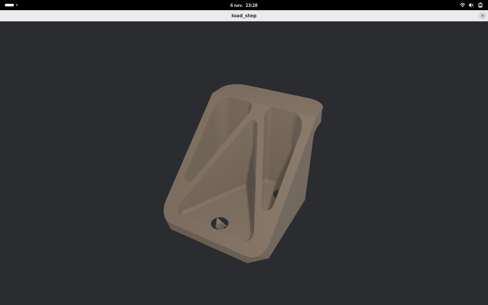

# step_link

[](https://crates.io/crates/step_link)
[](https://docs.rs/step_link)
[](https://crates.io/crates/step_link)
[](#licence)
[](https://github.com/jorgeandrecastro/step_link/actions)
[](https://www.rust-lang.org)

Moteur géométrique **B-Rep** et parser **STEP (ISO 10303-21)** en pur Rust, pensé pour être utilisé notamment avec [Bevy](https://bevyengine.org).



*Pièce `WallHook_30mm.stp` (63 faces, 744 triangles) chargée directement depuis le fichier STEP, sans conversion, avec le parser et le tessellateur de `step_link`.*

## Vision

Importer des pièces CAO (`.step` / `.stp`) directement dans un moteur de jeu ou un viewer, sans passer par une conversion externe en STL/OBJ, et en conservant la topologie B-Rep (solides, coques, faces, arêtes, sommets) pour des usages futurs : mesure, sélection de faces, retessellation à la volée.

Le format natif de Fusion 360 (`.f3d`) n'est pas lisible : dans Fusion, exporter via *Fichier → Exporter → STEP*.

Le projet est découpé en deux crates :

| Crate | Rôle |
|---|---|
| [`step_link`](https://crates.io/crates/step_link) | Cœur pur Rust : topologie B-Rep, parser STEP, tessellation. **Aucune dépendance Bevy.** |
| [`bevy_step_link`](https://crates.io/crates/bevy_step_link) | `StepLinkPlugin` + `AssetLoader` Bevy : `.step` / `.stp` → `Mesh`. |

## État d'avancement

- [x] Modèle B-Rep : `Solid` → `Shell` → `Face` (`Surface`, boucle externe et boucles internes) → `OrientedEdge` → `Edge` (`Curve`) → `Vertex`, arêtes partagées par index
- [x] Tessellation : plans, cylindres, cônes, contours courbes et trous (*ear clipping*)
- [x] `AssetLoader` Bevy + plugin
- [x] Parser Part 21 : en-tête, entités, paramètres typés, entités complexes, commentaires
- [x] Reconstruction de la topologie à partir des entités STEP (plans, cylindres, cônes, sphères, tores ; droites, cercles, ellipses, B-splines)
- [x] Validé sur un export réel (`WallHook_30mm.stp`) : affichage correct dans Bevy

> Sphères, tores et surfaces B-spline ne sont pas encore tessellés : ces faces sont absentes du maillage.

## Roadmap

### 1. Parser Part 21 générique ✅
Lexer et graphe `#id → entité` (`parse_part21`). Paramètres : références, entiers, réels, chaînes, énumérations, listes, valeurs typées, `$` et `*`. Entités complexes `#5 = (A() B())`.

- [ ] Décoder les séquences d'échappement des chaînes (`\X\`, `\X2\`)
- [x] Test sur un vrai export (`WallHook_30mm.stp`)
- [ ] Tests sur d'autres exports (Fusion 360, FreeCAD, SolidWorks)
- [ ] Fuzzing du lexer (`cargo fuzz`), aucune panique sur fichier malformé

### 2. Modèle B-Rep complet ✅
`Face { surface, outer_loop, inner_loops, same_sense }`, `Surface` (plan, cylindre, cône, sphère, tore, B-spline), `Curve` (droite, cercle, ellipse, B-spline), arêtes partagées par index.

### 3. Entités STEP vers topologie ✅
Chaîne `MANIFOLD_SOLID_BREP → CLOSED_SHELL → ADVANCED_FACE → FACE_BOUND → EDGE_LOOP → ORIENTED_EDGE → EDGE_CURVE → VERTEX_POINT → CARTESIAN_POINT`, surfaces (plan, cylindre, cône, sphère, tore) et courbes (droite, cercle, ellipse, B-spline). Validé sur un export réel de 63 faces.

- [ ] `BREP_WITH_VOIDS`
- [x] Courbes B-splines rationnelles (entités complexes)
- [ ] Surfaces B-spline et NURBS (lecture), `SURFACE_CURVE`
- [x] Les faces à surface non prise en charge sont ignorées avec un avertissement, au lieu de faire échouer le fichier
- [ ] Contour externe : sans `FACE_OUTER_BOUND`, le premier contour est supposé externe
- [ ] Unités non SI (pouces, `CONVERSION_BASED_UNIT`)

### 4. Tessellation (en cours)
- [x] Plans : *ear clipping* avec trous
- [x] Cylindres et cônes : triangulation dans l'espace paramétrique (angle, hauteur)
- [x] Discrétisation des arêtes partagée entre faces voisines
- [x] Tolérance (flèche maximale) configurable (`tessellate_with_tolerance`)
- [ ] Sphères et tores
- [ ] Surfaces B-spline/NURBS : projection des contours en (u, v) et points intérieurs
- [ ] Subdivision intérieure des faces courbes (seuls les points du bord sont utilisés)
- [ ] Soudure des sommets entre faces
- [ ] Vérifier le fond des trous coniques (artefact visible sur `WallHook_30mm`)

### 5. Intégration Bevy
- [x] Pavé de remplacement supprimé : un fichier sans solide est une erreur de chargement
- [x] Conversion d'unités et d'axes (mm / Z-up vers m / Y-up) faite par le loader
- [ ] Plusieurs solides et assemblages (`NEXT_ASSEMBLY_USAGE_OCCURRENCE`, transformations)
- [ ] Réglages du loader (tolérance, échelle) via `type Settings`
- [ ] Couleurs (`STYLED_ITEM`)

### 6. Robustesse et publication
- [ ] Corpus de pièces de complexité croissante : cube, cylindre percé, pièce avec congés
- [ ] Documentation et exemples complets
- [ ] Publication sur crates.io

## Installation

```toml
[dependencies]
bevy = "0.20"
bevy_step_link = "0.1"
```

Pour utiliser uniquement le cœur, sans Bevy :

```toml
[dependencies]
step_link = "0.1"
```

## Exemple (Bevy)

Placez votre fichier dans `assets/models/part.step`.

```rust
use bevy::prelude::*;
use bevy_step_link::StepLinkPlugin;

fn main() {
    App::new()
        .add_plugins((DefaultPlugins, StepLinkPlugin))
        .add_systems(Startup, setup)
        .run();
}

fn setup(
    mut commands: Commands,
    assets: Res<AssetServer>,
    mut materials: ResMut<Assets<StandardMaterial>>,
) {
    // Le .step est chargé directement comme un Mesh.
    let mesh: Handle<Mesh> = assets.load("models/part.step");

    // Le loader convertit en mètres et en Y-up : une pièce de 40 mm fait 0.04 unité.
    // On l'agrandit ici pour la voir avec la caméra ci-dessous.
    commands.spawn((
        Mesh3d(mesh),
        MeshMaterial3d(materials.add(Color::srgb(0.8, 0.7, 0.6))),
        Transform::from_scale(Vec3::splat(50.0)),
    ));

    // Sans caméra, Bevy n'affiche que le fond gris.
    commands.spawn((
        Camera3d::default(),
        Transform::from_xyz(-3.0, 3.0, 6.0).looking_at(Vec3::ZERO, Vec3::Y),
    ));

    commands.spawn((PointLight::default(), Transform::from_xyz(4.0, 8.0, 4.0)));
}
```

Exemple complet avec caméra orbitale (clic gauche + glisser pour tourner, molette pour zoomer) :

```sh
cargo run -p bevy_step_link --example load_step
```

## Exemple (pur Rust)

```rust
use step_link::{brep::Solid, mesh::tessellate};

let mesh = tessellate(&Solid::cuboid(1.0, 1.0, 1.0));
println!("{} triangles", mesh.triangle_count());
```

Lecture d'un fichier STEP :

```rust
use step_link::parser::parse_part21;

let file = parse_part21(&std::fs::read_to_string("piece.step").unwrap()).unwrap();
println!("{} entités", file.entities.len());
```

Inspection d'un fichier (comptage des entités, statistiques du solide) :

```sh
cargo run -p step_link --example inspect -- piece.step
```

## Développement

```sh
cargo check --workspace
cargo test --workspace
```

## Contribuer

Les issues et pull requests sont les bienvenues sur [GitHub](https://github.com/jorgeandrecastro/step_link/issues).
Si une pièce STEP ne se charge pas correctement, joignez le fichier (ou un extrait) à l'issue : les cas réels sont précieux pour faire avancer le parser et le tessellateur.

## Auteur

**Jorge Andre Castro** : [@jorgeandrecastro](https://github.com/jorgeandrecastro)

## Licence

Distribué sous double licence, à votre choix :

- [Apache License, Version 2.0](https://github.com/jorgeandrecastro/step_link/blob/main/LICENSE-APACHE)
- [MIT license](https://github.com/jorgeandrecastro/step_link/blob/main/LICENSE-MIT)

