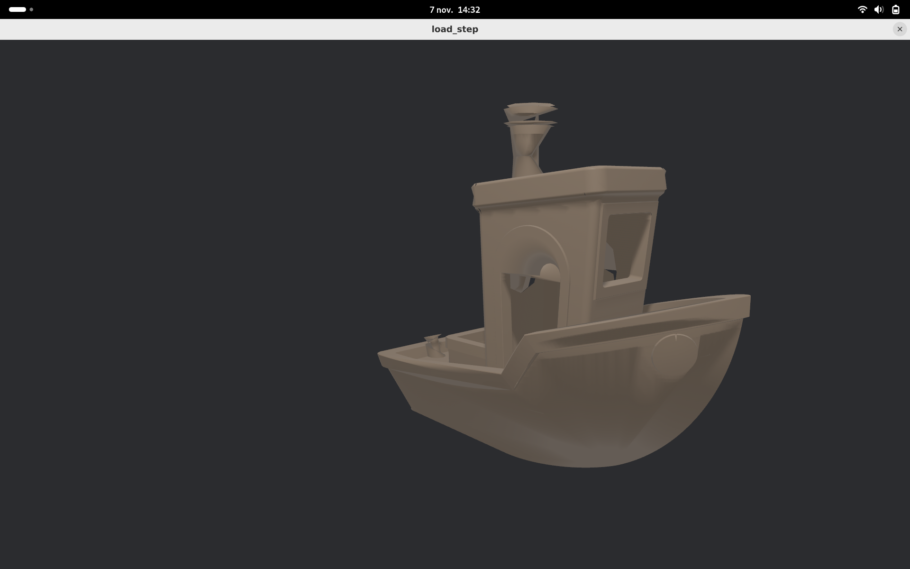

# step_link

[](https://crates.io/crates/step_link)
[](https://docs.rs/step_link)
[](https://crates.io/crates/step_link)
[](#license)
[](https://github.com/jorgeandrecastro/step_link/actions)
[](https://www.rust-lang.org)

Pure Rust **B-Rep** geometric engine and **STEP (ISO 10303-21)** parser, designed for seamless integration with [Bevy](https://bevyengine.org).



*`3DBenchy.step` model rendered in Bevy.*

## Vision

Import CAD parts (`.step` / `.stp`) directly into a game engine or viewer without going through an external STL/OBJ conversion, preserving the B-Rep topology (solids, shells, faces, edges, vertices) for future use cases: measurement, face selection, and on-the-fly retessellation.

Fusion 360's native format (`.f3d`) is not supported: in Fusion, export via *File → Export → STEP*.

The project is split into two crates:

| Crate | Role |
|---|---|
| [`step_link`](https://crates.io/crates/step_link) | Pure Rust core: B-Rep topology, STEP parser, tessellation. **Zero Bevy dependencies.** |
| [`bevy_step_link`](https://crates.io/crates/bevy_step_link) | `StepLinkPlugin` + Bevy `AssetLoader`: `.step` / `.stp` → `Mesh`. |

## Project Tree

```text
step_link/
├── Cargo.toml
├── Cargo.lock
├── CHANGELOG.md
├── crates/
│   ├── step_link/                 # Pure Rust core
│   │   ├── examples/
│   │   │   └── inspect.rs
│   │   └── src/
│   │       ├── brep.rs            # B-Rep topological model
│   │       ├── builder.rs         # Reconstruction from STEP entities
│   │       ├── lib.rs
│   │       ├── mesh/
│   │       │   ├── mod.rs         # Tessellation and MeshData type
│   │       │   ├── chart.rs       # Surface projection into UV space
│   │       │   ├── edges.rs       # Edge discretization and caching
│   │       │   ├── spline.rs      # B-spline curve and surface evaluation
│   │       │   └── triangulate.rs # Constrained Delaunay (spade) + ear clipping fallback
│   │       └── parser.rs          # Part 21 parser
│   └── bevy_step_link/            # Bevy integration
│       ├── assets/
│       │   └── models/
│       │       └── part.step
│       ├── examples/
│       │   └── load_step.rs
│       └── src/
│           ├── lib.rs
│           └── loader.rs
├── images/
│   └── image2.png
├── LICENSE-APACHE
└── LICENSE-MIT
```

## Current Status

- [x] B-Rep model: `Solid` → `Shell` → `Face` (`Surface`, outer loop and inner loops) → `OrientedEdge` → `Edge` (`Curve`) → `Vertex`, index-shared edges
- [x] Tessellation: planes, cylinders, cones, spheres, tori, B-spline surfaces, curved contours and holes (constrained Delaunay via [`spade`](https://crates.io/crates/spade), *ear clipping* fallback)
- [x] Interior points and analytical normals on spheres, tori, and B-spline/NURBS surfaces (0.4)
- [x] Solid and face STEP colors (`STYLED_ITEM`) transferred to the mesh and rendered in Bevy (0.5)
- [x] Bevy `AssetLoader` + plugin
- [x] Part 21 parser: header, entities, typed parameters, complex entities, comments
- [x] Topology reconstruction from STEP entities (planes, cylinders, cones, spheres, tori; lines, circles, ellipses, B-splines)
- [x] Validated on a real-world export (`WallHook_30mm.stp`): displays accurately in Bevy

> Since 0.4, curved faces (spheres, tori, B-splines/NURBS) receive interior points whose density follows the tolerance: they are no longer faceted. Cylinders and cones (ruled surfaces) remain triangulated by their contours.

Since 0.5, solid and face STEP colors are preserved in the mesh. A face color overrides the solid color; faces without a color receive a neutral tint when a mesh contains colors.

## Roadmap

### 1. Generic Part 21 Parser ✅
Lexer and `#id → entity` graph (`parse_part21`). Parameters: references, integers, reals, strings, enumerations, lists, typed values, `$` and `*`. Complex entities `#5 = (A() B())`.

- [ ] Decode string escape sequences (`\X\`, `\X2\`)
- [x] Tested on a real export (`WallHook_30mm.stp`)
- [ ] Tests on other exports (Fusion 360, FreeCAD, SolidWorks)
- [ ] Lexer fuzzing (`cargo fuzz`), zero panics on malformed files

### 2. Full B-Rep Model ✅
`Face { surface, outer_loop, inner_loops, same_sense }`, `Surface` (plane, cylinder, cone, sphere, torus, B-spline), `Curve` (line, circle, ellipse, B-spline), index-shared edges.

### 3. STEP Entities to Topology ✅
Chain `MANIFOLD_SOLID_BREP → CLOSED_SHELL → ADVANCED_FACE → FACE_BOUND → EDGE_LOOP → ORIENTED_EDGE → EDGE_CURVE → VERTEX_POINT → CARTESIAN_POINT`, surfaces (plane, cylinder, cone, sphere, torus) and curves (line, circle, ellipse, B-spline). Validated on a real 63-face export.

- [ ] `BREP_WITH_VOIDS`
- [x] Rational B-spline curves (complex entities)
- [x] B-spline and NURBS surfaces (parsing, including rational ones)
- [ ] `SURFACE_CURVE`
- [x] Faces with unsupported surfaces are skipped with a warning rather than failing the entire file
- [ ] Outer boundary: without `FACE_OUTER_BOUND`, assume the first loop is outer
- [ ] Non-SI units (inches, `CONVERSION_BASED_UNIT`)

### 4. Tessellation (in progress)
- [x] Planes: constrained Delaunay with holes
- [x] Cylinders and cones: triangulation in parametric space (angle, height)
- [x] Spheres and tori
- [x] Shared edge discretization between adjacent faces
- [x] Configurable tolerance (max sag) (`tessellate_with_tolerance`)
- [x] B-spline/NURBS surfaces: contour projection into (u, v)
- [x] B-spline/NURBS surfaces, spheres, and tori: interior points
- [x] Interior subdivision of curved faces (honeycomb grid in UV space)
- [x] Fallback to *ear clipping* on pathological contours
- [ ] Interior points for cylinders and cones (angular rails) if faceting remains visible
- [ ] Vertex welding across faces
- [ ] Check the bottom of conical holes (artifact visible on `WallHook_30mm`)

### 5. Bevy Integration
- [x] Fallback box removed: a file with no solids returns a load error
- [x] Unit and axis conversion (mm / Z-up to m / Y-up) handled by the loader
- [ ] Multiple solids and assemblies (`NEXT_ASSEMBLY_USAGE_OCCURRENCE`, transforms)
- [ ] Loader settings (tolerance, scale) via `type Settings`
- [x] Solid and face colors (`STYLED_ITEM`), rendered as vertex colors

### 6. Robustness & Publishing
- [ ] Corpus of parts with increasing complexity: cube, drilled cylinder, filleted part
- [ ] Comprehensive documentation and examples
- [x] Published on crates.io

## Installation

```toml
[dependencies]
bevy = "0.20"
bevy_step_link = "0.5"
```

To use only the core library without Bevy:

```toml
[dependencies]
step_link = "0.5"
```

## Example (Bevy)

Place your file at `assets/models/part.step`.

```rust
use bevy::prelude::*;
use bevy_step_link::StepLinkPlugin;

fn main() {
    App::new()
        .add_plugins((DefaultPlugins, StepLinkPlugin))
        .add_systems(Startup, setup)
        .run();
}

fn setup(
    mut commands: Commands,
    assets: Res<AssetServer>,
    mut materials: ResMut<Assets<StandardMaterial>>,
) {
    // The .step file is loaded directly as a Mesh.
    let mesh: Handle<Mesh> = assets.load("models/part.step");

    // The loader converts units to meters and axes to Y-up: a 40 mm part equals 0.04 units.
    // Scaling it up here to make it visible with the camera below.
    commands.spawn((
        Mesh3d(mesh),
        MeshMaterial3d(materials.add(Color::srgb(0.8, 0.7, 0.6))),
        Transform::from_scale(Vec3::splat(50.0)),
    ));

    // Without a camera, Bevy only renders a gray background.
    commands.spawn((
        Camera3d::default(),
        Transform::from_xyz(-3.0, 3.0, 6.0).looking_at(Vec3::ZERO, Vec3::Y),
    ));

    commands.spawn((PointLight::default(), Transform::from_xyz(4.0, 8.0, 4.0)));
}
```

Full example with orbit camera (left click + drag to orbit, scroll wheel to zoom):

```sh
cargo run -p bevy_step_link --example load_step
```

## Example (Pure Rust)

```rust
use step_link::{brep::Solid, mesh::tessellate};

let mesh = tessellate(&Solid::cuboid(1.0, 1.0, 1.0));
println!("{} triangles", mesh.triangle_count());
```

Reading a STEP file:

```rust
use step_link::parser::parse_part21;

let file = parse_part21(&std::fs::read_to_string("part.step").unwrap()).unwrap();
println!("{} entities", file.entities.len());
```

Inspecting a file (entity count, solid statistics):

```sh
cargo run -p step_link --example inspect -- crates/bevy_step_link/assets/models/part.step
cargo run -p step_link --example inspect -- crates/bevy_step_link/assets/models/UMI-HH-01_Handle.step
```

Run these commands from the repository root. The second command requires `UMI-HH-01_Handle.step` to be present in the models directory. The command accepts a `.step` or `.stp` path, relative to the current directory or absolute. It outputs STEP entities, reconstructed solids, skipped faces, and triangle counts; read, parse, or reconstruction errors are printed to the terminal.

To visually inspect a new part in Bevy, place it at `crates/bevy_step_link/assets/models/part.step` (or update the `models/part.step` path in `crates/bevy_step_link/examples/load_step.rs`), then run:

```sh
cargo run -p bevy_step_link --example load_step
```

The loader converts units to meters and axes to Y-up, and tessellates with a 0.05 mm tolerance converted to file units. The inspector reports the detected unit scale and uses the same tolerance. Unknown and non-SI units currently default to meters. Tessellation diagnostics report skipped contours and triangulation fallbacks on standard error.

`cargo test --workspace` runs the project's automated test suite; this command does not automatically load an arbitrary STEP file.

## Development

```sh
cargo check --workspace
cargo test --workspace
```

## Contributing

Issues and pull requests are welcome on [GitHub](https://github.com/jorgeandrecastro/step_link/issues).
If a STEP part fails to load properly, please attach the file (or an excerpt) to the issue: real-world test cases are invaluable for improving the parser and tessellator.

## Author

**Jorge Andre Castro** : [@jorgeandrecastro](https://github.com/jorgeandrecastro)

## License

Dual-licensed under either of the following, at your option:

- [Apache License, Version 2.0](https://github.com/jorgeandrecastro/step_link/blob/main/LICENSE-APACHE)
- [MIT license](https://github.com/jorgeandrecastro/step_link/blob/main/LICENSE-MIT)